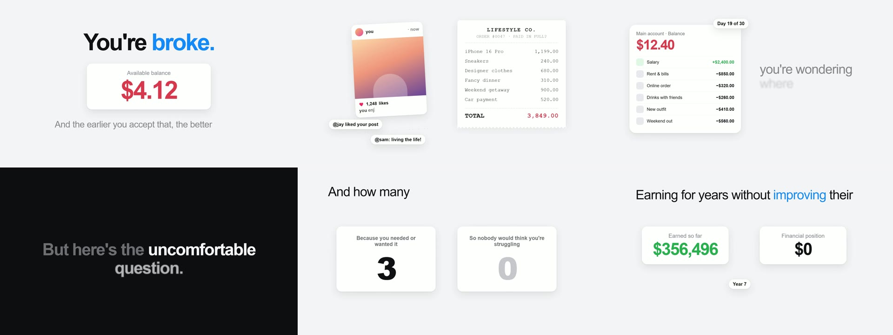
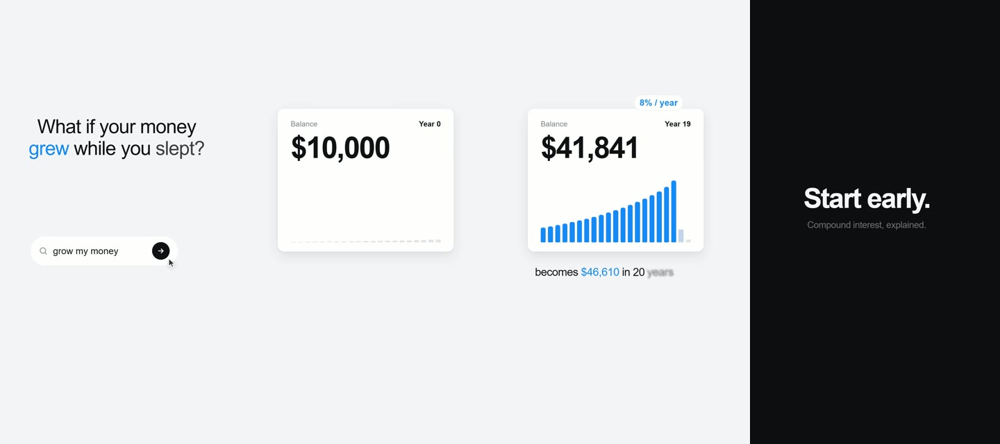
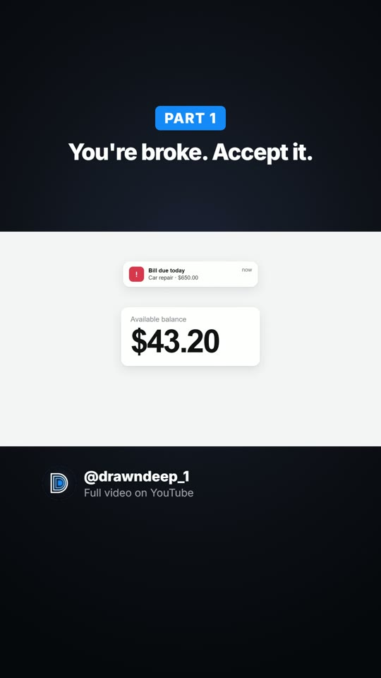

# Clean Motion Video: a motion-graphics video skill for AI coding agents

Turn an idea, a script, or your own voiceover into a finished **motion-graphics video with voiceover**:
clean "UI motion design" visuals, words that appear exactly as they're spoken, a sound effect on every
action, a subscribe/follow call to action, a YouTube thumbnail, and ready-to-post TikTok parts.

Works with **Claude Code, OpenAI Codex, Google Antigravity, Gemini CLI, Cursor, GitHub Copilot, OpenCode,
Windsurf** and any agent that reads the open [Agent Skills](https://agentskills.io) `SKILL.md` format.
Everything runs locally with free tools: no paid APIs, no sign-ins.



| Vertical short (TikTok / Reels / Shorts) | Ready-to-post TikTok part from a long video | Generated YouTube thumbnail |
|---|---|---|
|  |  |  |

## What it does
- **Any length:** 8-second shorts to 10+ minute explainers (long films are built and rendered in chapters).
- **Any input:** a topic ("make a 15 s ad for my bakery"), your own script (kept word for word), or your
  own voiceover recording (cleaned, paced, transcribed, and the visuals synced to every word).
- **Voices:** free local voices (Kokoro, 28 English voices; an audition board is included), your own
  recording, or Google Gemini TTS with your own free API key.
- **Looks:** a clean Apple-like default plus looks for history/art (paper), tech/AI (midnight), ads (bold),
  lifestyle (sunset), luxury (forest), kids (candy), true stories (noir).
- **Edit your own footage:** give it raw talking-head clips (phone video, several takes) and it cuts the
  silences, "um"s, retakes and half-said restarts (every cut lands in real silence, and the whole edit is
  re-transcribed and checked for leftover fragments and repeats), cleans your voice, and builds a fast edit
  with motion graphics: headlines, stat cards, checklists, app-style mockups and real photos of what you
  mention. It mixes five layouts per video so videos don't all look the same (graphics above a face window
  with your head popping out, face on top, a big graphics stage with a face card, a floating card over your
  full-frame face, half and half), plus a look per video (window shape, background, entrances, caption
  style). Your head is measured across the whole clip so it is never cut off. Colour palettes included
  (warm Ghana gold, kente green, black + pink, light, ocean, mono) or bring your brand colours.
- **Real images when they matter:** for history, real places and people it fetches public-domain /
  CC0 / CC BY images (Wikimedia Commons, Openverse) and writes the credits.
- **Sound design:** a 76-sound kit in role groups (11 failure sounds, 7 whooshes, 7 pops…), rotated
  automatically so nothing repeats; every hit lands one frame after its visual.
- **Growth built in:** an organic subscribe + bell (long-form) or follow (shorts) overlay, YouTube titles,
  description with chapters, comma-separated tags, pinned comment, two thumbnails, and long videos cut
  into framed 9:16 "Part 1, Part 2…" TikTok videos with captions, ready to post.
- **Quality checks:** layout, safe areas, contrast and timing are checked and every beat is reviewed
  as a frame before rendering; audio is mastered to −14 LUFS.

Built on [HyperFrames](https://hyperframes.heygen.com) (HTML + GSAP rendered to MP4).

---

## Quick start: one prompt for your coding agent

Paste the prompt below into your AI coding agent (Claude Code, Codex, Antigravity, Gemini CLI, Cursor, …).
It installs the skill and everything it needs, reads the whole skill so it knows what it can do, then proves
the setup works by making a short test video. Change `claude-code` to your agent if needed.

````text
Set up the "clean-motion-video" skill on this computer, learn it completely, and test it.

1. INSTALL THE SKILL
   - Install it globally for this agent:
       npx skills add agbibrightlucien/motion-graphics-skill -g -a claude-code -y
     (other agents: -a codex | antigravity | gemini-cli | cursor | github-copilot | opencode | windsurf)
   - Install the HyperFrames skills it builds on:
       npx skills add heygen-com/hyperframes -g -a claude-code -y
   - If npx can't reach the repository (it is private), clone it with git
     (https://github.com/agbibrightlucien/motion-graphics-skill.git) and run install/install.ps1 on Windows or
     install/install.sh on macOS/Linux. If git asks me to sign in to GitHub, stop and tell me.
   - Tell me the folder the skill was installed to. Call it SKILL below.

2. INSTALL WHAT THE SKILL NEEDS (check first; install only what is missing; tell me before installing
   system-wide software)
   - Node.js 22+   (Windows: winget install OpenJS.NodeJS.LTS | macOS: brew install node | Linux: your package manager)
   - Python 3.9+   (Windows: winget install Python.Python.3.12 | macOS: brew install python)
   - ffmpeg with ffprobe (Windows: winget install Gyan.FFmpeg | macOS: brew install ffmpeg | Linux: sudo apt install ffmpeg)
   - Open a new terminal if a fresh install isn't on PATH yet, and confirm each version.
   - Run the skill's own setup check and fix anything marked "!!":
       python -I -u SKILL/scripts/cmv.py setup --test      (python3 on macOS/Linux)
   - Install the local speech-to-text model used for captions and footage editing:
       npx hyperframes models install parakeet
     (if it fails, the skill falls back to Whisper; say so and continue)
   - Everything is free and local. Don't sign up for paid services or ask me for API keys. The only optional
     key is a Google Gemini key for Gemini voices, and that is my choice to add later.

3. LEARN THE WHOLE SKILL BEFORE USING IT
   Read every file, not just the summary:
   - SKILL/SKILL.md (the workflow and the rules)
   - every file in SKILL/references/: style-guide, looks, scene-patterns, cm-kit (motion helpers),
     scripts (writing), sfx-kit (sound), real-images, publish-pack (YouTube/TikTok delivery),
     footage (editing raw footage: cutting, style A layouts, captions, voice, face windows),
     source-analysis
   - the scripts in SKILL/scripts/: cmv.py (the pipeline: new, voice, voices, assemble, cta, thumb, tiktok,
     package, chapters, master, setup, hf), footage.py (ingest, beats, face, cutout, scaffold),
     review_joins.py, fetch_images.py, fetch_sfx_variants.py, add_sfx_variants.py, and longform/
   - SKILL/template/ (the project template, cm-kit.js/.css, footage-kit.css) and the worked example in
     SKILL/examples/compound-interest/ (read its plan, scenes and scripts to see a finished video's source)
   - the HyperFrames skill you installed (its SKILL.md and the references it lists), since every video is a
     HyperFrames project
   Then give me a short summary: what the skill can make, the steps of a video from idea to delivered files,
   the footage-editing steps, the voices available, and the rules it enforces. Keep it to one screen.

4. TEST: MAKE A VIDEO FROM SCRATCH
   In a new folder (for example ~/motion-graphics-test), use the skill exactly as its SKILL.md says to make a
   15-20 second vertical (1080x1920) motion-graphics explainer on "Why compound interest beats saving",
   voiced with the local Kokoro voice af_heart. Go through every step: script, voice, scenes, the
   check, snapshots of the frames (look at them), render, master, package. When it's done, tell me the path of
   the finished MP4 and the YouTube/ and TikTok/ folders, its length and loudness, and show me two or three
   frames.

5. TEST: FOOTAGE EDITING (only if I give you a clip)
   Ask me whether I have a short talking-head clip (a phone video of me talking, 20-60 s). If I do, run the
   footage workflow from references/footage.md on it: ingest, review every cut with review_joins.py, beats in
   style A, cutout, scaffold, design the beats, check, snapshot (every ~1.5 s), render, master. If I don't, skip
   this step and say so.

6. REPORT
   List what you installed (with versions), where the skill lives, what passed, what failed and how you fixed
   it, and anything I still need to do myself. Don't hide warnings.
````

What to expect: installing takes 5-15 minutes, mostly downloads (the voice model, the speech model and a
headless browser for rendering, a few hundred MB each). The test video then takes a few minutes. If your
agent can't run long commands, it will tell you which command to run yourself.

---

## Requirements (install once)
| Tool | Why | Install |
|---|---|---|
| **Node.js 22+** | runs HyperFrames (rendering) and the skill installer | [nodejs.org](https://nodejs.org) · `winget install OpenJS.NodeJS.LTS` · `brew install node` |
| **Python 3.9+** | the skill's pipeline script; local voice + transcription | [python.org](https://www.python.org/downloads/) · `winget install Python.Python.3.12` · `brew install python` |
| **ffmpeg** (with ffprobe) | audio cleanup, mastering, cutting | `winget install Gyan.FFmpeg` · `brew install ffmpeg` · `sudo apt install ffmpeg` |
| An AI coding agent | runs the skill | Claude Code, Codex, Antigravity, Gemini CLI, Cursor, … |

About 8 GB of free RAM is comfortable for rendering. The first voice and the first transcription each
download a model (a few hundred MB) automatically; the first render downloads a headless browser.

---

## Install

> **This repository is private.** Ask the owner to invite your GitHub account (Settings → Collaborators),
> accept the email invitation, and make sure git on your computer is signed in to GitHub: run
> `gh auth login` (GitHub CLI), or just `git clone` the repo once and sign in when the browser window
> opens (Git Credential Manager, included with Git for Windows). After that, every option below works.

### Option A: one command (recommended)
Uses the open-source [skills CLI](https://github.com/vercel-labs/skills), which installs into any agent.

```bash
# 1) this skill (global = available in every project)
npx skills add agbibrightlucien/motion-graphics-skill -g -a claude-code
#   other agents: -a codex | -a antigravity | -a gemini-cli | -a cursor | -a github-copilot | -a opencode | -a windsurf
#   several at once: -a claude-code -a codex -a antigravity      all detected agents: -a '*'

# 2) the HyperFrames skills it builds on (same agent flags)
npx skills add heygen-com/hyperframes -g -a claude-code
```
Leave out `-g` to install into the current project only. Add `-y` to skip the prompts.

### Option B: installer script (no npx needed for the skill itself)
Clone or download this repository, then:

**Windows (PowerShell)**
```powershell
git clone https://github.com/agbibrightlucien/motion-graphics-skill.git
cd motion-graphics-skill
powershell -ExecutionPolicy Bypass -File install\install.ps1 -Agent claude,codex,antigravity -Scope global
```
**macOS / Linux**
```bash
git clone https://github.com/agbibrightlucien/motion-graphics-skill.git
cd motion-graphics-skill
bash install/install.sh --agent claude,codex,antigravity --scope global
```
Agents: `claude`, `codex`, `antigravity`, `gemini`, `cursor`, `copilot`, `opencode`, `windsurf`, or `all`.
Scope: `global` (every project) or `project` (add `-ProjectPath <folder>` / `--project <folder>`, default:
current folder). The script copies `skills/clean-motion-video`, offers to install the HyperFrames skills,
and runs the setup check.

### Option C: manual copy (per agent)
Copy the folder `skills/clean-motion-video` (the folder that contains `SKILL.md`) to:

| Agent | Global (all projects) | This project only |
|---|---|---|
| **Claude Code** | `~/.claude/skills/clean-motion-video/` | `<project>/.claude/skills/clean-motion-video/` |
| **OpenAI Codex** | `~/.agents/skills/clean-motion-video/` (older builds: `~/.codex/skills/`) | `<project>/.agents/skills/clean-motion-video/` |
| **Google Antigravity** | `~/.gemini/config/skills/clean-motion-video/` (legacy: `~/.gemini/antigravity/skills/`) | `<project>/.agents/skills/clean-motion-video/` |
| **Gemini CLI** | `~/.gemini/skills/clean-motion-video/` | `<project>/.agents/skills/clean-motion-video/` |
| **Cursor** | `~/.cursor/skills/clean-motion-video/` | `<project>/.agents/skills/clean-motion-video/` |
| **GitHub Copilot** | `~/.copilot/skills/clean-motion-video/` | `<project>/.agents/skills/clean-motion-video/` |
| **OpenCode** | `~/.config/opencode/skills/clean-motion-video/` | `<project>/.agents/skills/clean-motion-video/` |
| **Windsurf** | `~/.codeium/windsurf/skills/clean-motion-video/` | `<project>/.windsurf/skills/clean-motion-video/` |

`~` is your home folder (`C:\Users\<you>` on Windows). Restart the agent (or start a new session) so it
picks the skill up. Then install the HyperFrames skills with `npx skills add heygen-com/hyperframes`
(they're optional but improve results; without them the skill runs HyperFrames through `npx`).

### Finish setup (once per machine)
Ask your agent *"run the clean-motion-video setup"*, or run it yourself from the skill folder:
```bash
python -I -u <skill-folder>/scripts/cmv.py setup --test      # python3 on macOS/Linux
```
It checks Node.js, Python, ffmpeg and HyperFrames, and installs the HyperFrames library sounds into the kit.

---

## Use it
Start your agent in the folder where you want your videos and just ask. The skill activates on requests
like these (or call it by name: `/clean-motion-video` in Claude Code, `$clean-motion-video` in Codex):

- *"Make a 20-second vertical explainer about compound interest, with a female voice."*
- *"Here's my script: … Turn it into a landscape YouTube video, history style."*
- *"I recorded a voiceover at `C:\Users\me\Desktop\vo.wav`. Make the full video for it."*
- *"Make a 15-second ad for my bakery, bold look, my logo is `logo.png`, follow CTA for @mybakery."*
- *"Let me hear all the voices first."* (it builds the audition board)
- *"Here's my raw video `C:\Users\me\Videos\take1.mp4`. Edit it into a TikTok: cut the pauses, add captions and graphics for what I talk about."*

The agent asks only what it can't infer (format, length, voice, your channel name for the CTA), shows
you the plan for longer videos, builds and checks every scene, renders, and delivers two folders per video:

```
projects/<name>/YouTube/   <Title>.mp4 (upload this) · thumbnail-v1.png · thumbnail-v2.png · YOUTUBE.md (titles, description, tags, pinned comment) · CREDITS.md
projects/<name>/TikTok/    Part 1 - <title>.mp4 · Part 1 - caption.txt · … · TIKTOK.md
```

**Time:** a 20-second short takes a few minutes to render; a 10-minute film is built in ~75-second
chapters (you approve chapter 1 first) and renders at roughly 2–3× real time per chapter.

`extras/voice-audition/` has all 28 local voices reading the same line (`ALL_VOICES_in_order.mp3` plays
them in order), so you can pick one before you start. Recommended: `af_heart` (female), `am_adam` /
`am_liam` (male).

---

## Repository layout
```
skills/clean-motion-video/     the skill (this is what gets installed)
  SKILL.md                     instructions the agent follows
  scripts/cmv.py               pipeline: new, voice, voices, assemble, cta, thumb, tiktok, package, chapters, master, setup, hf …
  scripts/footage.py           footage editing: ingest (cut + clean + transcribe), beats, face, cutout, scaffold
  scripts/review_joins.py      lists every cut in a footage edit so each join can be checked
  scripts/fetch_images.py      free-licensed real images (Wikimedia Commons, Openverse)
  scripts/fetch_sfx_variants.py, add_sfx_variants.py   grow the sound kit (CC0)
  scripts/longform/            scene builder + checker for chaptered long films, with a real example
  references/                  style guide, looks, scene patterns, motion API, scripts, sound kit, publish pack, footage editing …
  template/                    project template, motion helpers (cm-kit.js/.css), CTA, thumbnail, TikTok frames
  assets/sfx/                  61 sounds (+15 installed by setup) with manifest and credits
  examples/compound-interest/  a complete worked example
extras/voice-audition/         the 28 Kokoro voices, one line each
install/                       install.ps1 (Windows), install.sh (macOS/Linux)
docs/images/                   screenshots used in this README
```

## Troubleshooting
| Problem | Fix |
|---|---|
| `npm error notarget No matching version found for hyperframes@…` | A HyperFrames release isn't downloadable yet. The skill pins a tested version; set `HYPERFRAMES_STANDALONE_CLI_VERSION` to a version that works, e.g. `0.9.97`. |
| `tts` says Python is required | Set `HYPERFRAMES_PYTHON` to your Python's full path (`python -c "import sys;print(sys.executable)"`). The skill sets it automatically when it runs the voice step. |
| A render dies at "Starting browsers" | Not enough free memory: close apps and render one thing at a time (`--workers 2`). |
| Words "vibrate" as they appear on fast narration | Long films use the calm word style automatically; for a short, set `data-word-style="soft"` on the root in `index.html`. |
| Gemini voice fails with 400/404 | The TTS model name changed: set `"gemini_model"` in `plan.json` to the current `*-tts` model from Google AI Studio. |
| The agent doesn't use the skill | Check the folder is in the right place (table above) with `SKILL.md` directly inside, start a new session, or call it by name. |

## Credits and licences
- Code and documentation: MIT (see `LICENSE`).
- Sounds: CC0 and CC BY files are included with their credits in `skills/clean-motion-video/assets/sfx/CREDITS.md`;
  CC BY sounds must be credited where a video using them is published (the skill writes the credits for you).
  15 library sounds from HyperFrames (Pixabay licence) are not redistributed; `setup` installs them from
  your own HyperFrames install. Details in `THIRD_PARTY_NOTICES.md`.
- Voices: [Kokoro-82M](https://huggingface.co/hexgrad/Kokoro-82M) (Apache-2.0), run through HyperFrames.
- Rendering: [HyperFrames](https://github.com/heygen-com/hyperframes) by HeyGen.
- The default visual language was studied from short-form "UI motion design" videos; all graphics are original.
